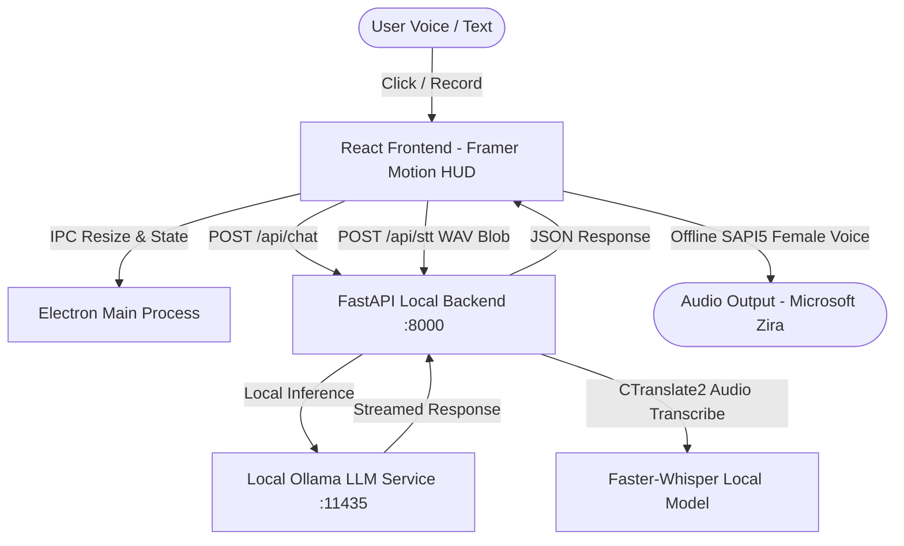

# 🌌 Tactical AI Companion (Dynamic HUD Edition)

A high-performance, **100% local and offline** desktop AI companion widget built with **Electron**, **React (Vite + Tailwind CSS + Framer Motion)**, and a **FastAPI + Ollama + Faster-Whisper** backend.

Featuring a top-of-screen floating **Dynamic Island** with smooth spring-physics morphing between a docked tactical telemetry pill and an expansive sci-fi landscape HUD.

---

## ⚡ Key Highlights

- **🏝️ Dynamic Island Window Morphing**:
  - **Docked State (`140px × 40px` inside `160px × 60px` safe area)**: Sleek top-center floating pill featuring an animated glowing telemetry circular gauge and dynamic status indicator.
  - **Expanded Landscape Dashboard (`1113px × 385px`)**: Tactical sci-fi HUD with dark glassmorphism (`bg-[#0d1117]/95`), backdrop blur, cyan/teal accent borders, and a HUD grid background.
  - **Zero-Clipping Mail-Slot Handshake**: Electron dynamically resizes the invisible transparent window boundaries (`160x60` ➔ `1150x420`) before expanding and delays shrinking until after Framer Motion exit animations complete (`stiffness: 350, damping: 25`).
- **🔒 100% Private, Local & Offline**:
  - **Brain (LLM)**: Offline local inference powered by Ollama (`llama3.2:1b`, `deepseek-r1:1.5b`, or any Ollama model) on port `11435`.
  - **Ears (STT)**: On-device `MediaRecorder` audio capture transcribed 100% offline using `faster-whisper-tiny.en` running on CPU/GPU via CTranslate2.
  - **Mouth (TTS)**: Offline female voice synthesis (`Microsoft Zira Desktop` / English female SAPI5 voices) with customized pitch and rate.
- **📊 Sci-Fi Tactical Telemetry HUD Components**:
  - **Header & Footer**: Live system cycles (`CYCLES 13,607`), environmental telemetry (`SPECTRUM 136 AQI`), status badge (`STEADY`), and model identifier (`LLM 1B (OFFLINE)`).
  - **Hardware & Audio Visualizer**: 16-bar active volume EQ meter (`51 dB`) + dual concentric SVG ring gauge tracking memory and token velocity (`1.32 OF 2.0 GB` & `46 TOK/SEC`).
  - **Tactical Action Controls**: 2x2 interactive button matrix (`RECON (VOICE)`, `ENGAGE`, `REGEN`, `MUTE`).
  - **Rigel Neural Stream**: Real-time typewriter animated text stream, historical conversation feed, and terminal prompt input.
- **⌨️ Global Shortcuts & Auto-Collapse**: Press `Ctrl+Shift+Y` anywhere to toggle or click outside the window (Blur event) to automatically collapse into pill mode.

---

## 🏗️ Architecture Overview



---

## 📂 Project Directory Structure

```text
ai-companion-device/
├── main.js                  # Electron main process (Window management & dynamic safe area resizing)
├── preload.js               # Secure contextBridge IPC bridge (resizeWindow, windowState)
├── start-companion.bat      # 1-Click launcher (Port cleanup, Ollama, Backend, Vite, Electron)
├── package.json             # Root workspace scripts & Electron dependencies
├── backend/
│   ├── main.py              # FastAPI server, REST & WebSocket routes
│   ├── ai_engine.py         # Ollama LLM streaming client & offline health checks
│   ├── voice_pipeline.py    # Offline Faster-Whisper STT & pyttsx3 voice synthesis
│   └── config.py            # Pydantic configuration, model paths & cache settings
├── ui/
│   ├── index.html           # HTML5 transparent shell template
│   ├── package.json         # React UI dependencies (Framer Motion, Lucide, Tailwind CSS)
│   ├── vite.config.js       # Vite configuration with Tailwind CSS plugin
│   └── src/
│       ├── main.jsx         # React application bootstrap entry
│       ├── App.jsx          # Complete Dynamic Island & Landscape HUD Component
│       └── styles.css       # Tailwind imports, HUD grid background & scrollbars
├── requirements.txt         # Python dependencies
├── .env.example             # Environment variable template
└── README.md                # Project documentation & full architecture summary
```

---

## 🚀 Quickstart & Installation

### Prerequisites
1. **Node.js** (v18+)
2. **Python** (3.10+)
3. **Ollama** installed locally (`ollama pull llama3.2:1b`)

### 1. Initial Setup
Clone the repository and install dependencies:

```powershell
# Install Node dependencies
npm install
cd ui && npm install && cd ..

# Setup Python Virtual Environment
python -m venv venv
.\venv\Scripts\activate
pip install -r requirements.txt
```

### 2. Launch the AI Companion (1-Click)
Run the automated launcher batch script:
```powershell
.\start-companion.bat
```
*This automatically initializes the Ollama service on port 11435, starts the FastAPI Whisper backend on port 8000, boots the Vite frontend on port 3000, and displays the frameless transparent desktop HUD.*

---

## ⌨️ Controls & Keyboard Shortcuts

| Action | Shortcut / Trigger | Description |
| :--- | :--- | :--- |
| **Expand HUD** | Click Docked Pill OR `Ctrl+Shift+Y` | Expands into full 1113x385 landscape tactical dashboard |
| **Collapse HUD** | Click `✕` Button OR Click outside window | Smoothly shrinks dashboard back into top-center pill |
| **Push-to-Talk (Offline STT)** | Click `RECON (VOICE)` | Records microphone audio and transcribes locally with Faster-Whisper |
| **Engage LLM** | Click `ENGAGE` OR Press `Enter` | Sends the current prompt to the local Ollama LLM core |
| **Regenerate Response** | Click `REGEN` | Requests a fresh diagnostic/response from the local model |
| **Mute Voice Output** | Click `MUTE` | Toggles speech synthesis audio readback |

---

## 📡 REST & WebSocket API Reference

| Endpoint | Type | Description |
| :--- | :--- | :--- |
| `GET /api/health` | REST | Verifies status of local Ollama model, Faster-Whisper, and audio hardware |
| `GET /api/config` | REST | Retrieves active configuration settings and audio device topology |
| `POST /api/chat` | REST | Sends prompt to local Ollama instance (`{ "prompt": "..." }`) |
| `POST /api/stt` | REST | Multipart upload of audio file/blob for offline Faster-Whisper transcription |
| `POST /api/tts` | REST | Synthesizes text to PCM audio stream |
| `WS /ws/audio` | WebSocket | Real-time bidirectional voice streaming, transcription, and token delivery |
| `WS /ws/terminal` | WebSocket | Real-time hardware telemetry and backend diagnostic logs |

---

## ⚙️ Customization & Model Switching

### Changing the Local LLM Model
To switch to another local model (e.g., DeepSeek R1 1.5B or Llama 3.2 3B):
1. Pull the model in your terminal:
   ```bash
   ollama pull deepseek-r1:1.5b
   # or
   ollama pull llama3.2:3b
   ```
2. Update `OLLAMA_MODEL` in `backend/config.py`:
   ```python
   OLLAMA_MODEL: str = "deepseek-r1:1.5b"
   ```

### Changing Voice Profiles
By default, the companion selects **Microsoft Zira Desktop** (Female SAPI5 voice). You can customize the pitch, rate, or voice profile in `ui/src/App.jsx` (`speakText` function) or in `backend/voice_pipeline.py`.

---

## 📄 License
MIT License. Free for open hardware prototyping, companion device casing, and personal enhancement.
