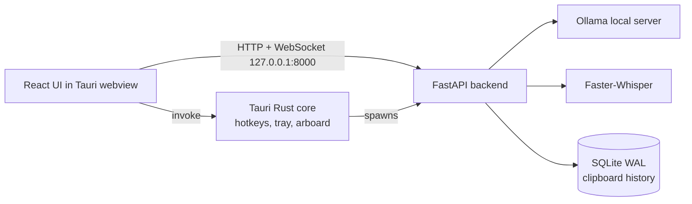

# AURA HUD

A Windows desktop AI assistant, built as an engineering project. A Tauri v2 (Rust) shell hosts a React UI, which talks to a local Python (FastAPI) backend. The backend uses a locally running Ollama model for chat and Faster-Whisper for speech-to-text.

**Status: work in progress.** See [Known limitations](#known-limitations) before relying on anything here.

## What works today

- Global hotkeys (`Ctrl+Shift+A`, `Ctrl+Shift+Space`) summon a frameless, always-on-top window positioned near the cursor and clamped to the screen edges. A tray icon provides summon, toggle and quit.
- The Rust side reads the OS clipboard through `arboard` and exposes it to the UI.
- The backend stores clipboard history in SQLite (WAL mode), with duplicate skipping and search.
- Chat streams over a WebSocket (`/api/stt/live`): text prompts go to Ollama and tokens stream back. Audio chunks are transcribed with Faster-Whisper (model loaded lazily on first use), then sent to Ollama.
- `POST /api/agent/query` asks the model for a structured JSON response containing an intent label (`CLIPBOARD_ACTION`, `KNOWLEDGE_QUERY`, `SYSTEM_DIAGNOSTIC`, `GENERAL_CHAT`). The label is returned to the caller. It does not trigger any tools yet.
- `GET /api/system/telemetry` returns CPU, RAM and disk usage via `psutil`. The UI Stats tab displays it.
- `GET /api/health` reports Ollama reachability and STT status.
- Ollama failures map to HTTP 503 (unreachable), 504 (timeout) and 502 (unparseable model output). STT failures are reported to the client as an explicit error event.

## Architecture



## Development setup

Prerequisites: Python 3.13, Node.js, Rust toolchain, [Ollama](https://ollama.com).

```powershell
python -m venv venv
.\venv\Scripts\activate
pip install -r requirements.txt -r requirements-dev.txt
ollama pull llama3.2:1b

# backend
python backend/main.py

# UI
cd ui
npm install
npm run dev
```

Configuration comes from environment variables or a `.env` file (see `.env.example`). Ollama's default URL is `http://127.0.0.1:11434`. Speech-to-text needs the Whisper model files, which Faster-Whisper downloads on first use unless they are already cached.

Running the full desktop shell (`cargo tauri dev`) and building an installer are not documented yet.

## Tests

```powershell
ruff check .
pytest -q
```

The backend tests mock Ollama at the HTTP transport layer (`httpx.MockTransport`), so the real request and stream-parsing code runs without a model. Speech-to-text is faked in the WebSocket tests. A real `tiny.en` test exists but is skipped by default (`pytest -m stt`). The Rust crate currently has no tests; CI runs `cargo clippy` and a build check. CI runs on every pull request.

## Known limitations

- **No authentication on the local API.** The backend binds to `127.0.0.1` but has no token, and CORS is still permissive. Hardening is planned next.
- **The backend sidecar is not supervised.** It is not restarted on crash and may be orphaned when the app quits.
- **No packaged installer or release yet.** The PyInstaller recipe (`aura-backend.spec`) has not been verified end to end.
- **"Offline" is not yet verified.** The design runs models locally, but there is no network-blocked test yet, and Whisper weights download on first run.
- **No text-to-speech.** An earlier placeholder was removed.
- **No performance measurements yet.** A reproducible benchmark (memory, startup, STT latency, end-to-end latency) is planned, and numbers will be added only once measured.
- **Frontend dev-dependency advisories.** `npm audit` reports advisories in build tooling (Vite/esbuild and related). These affect the dev toolchain, not the built UI, but they are unresolved.

## License

MIT